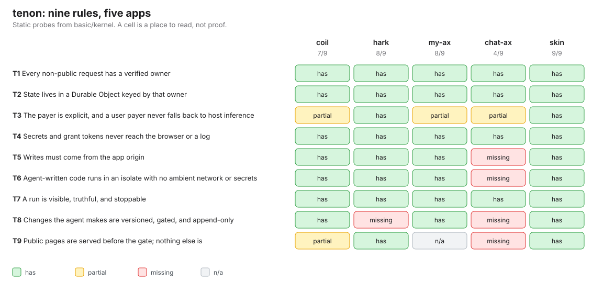

# tenon

Five agent apps, nine shared rules, and who breaks which.



The joint that coil, hark, my-ax, chat-ax and skin all share, cut once.

tenon is one Cloudflare Worker that implements nine invariants every owner-keyed agent app needs: verified owner, owner-keyed Durable Object state, an explicit payer, no secrets in responses, same-origin writes, agent code in a network-less isolate, truthful stoppable runs, gated append-only versions, and a small public surface. [OVERLAP.md](OVERLAP.md) defines them and maps where each app stands.

## Run it

```sh
npm install
npm run demo   # boots workerd, ships versions, rejects a broken one, rolls back, writes receipts/demo.png
npm test       # 15 security checks over HTTP against a real local workerd
npm run gate   # everything, including basic's kernel layer on all five apps
```

## Check another app

```sh
node ../basic/kernel/run.mjs --app=coil            # static: file:line evidence per invariant
BASE=https://… node ../basic/kernel/run.mjs --app=coil   # adds live probes
```

## For agents

- Rules: [`invariants.json`](invariants.json), the only source.
- Skill: [`SKILL.md`](SKILL.md).
- Fix tasks: `basic/reports/kernel-<app>.json`, one `fix` per gap, each with a proof command.

## Limits

- No Sign in with Cloudflare flow yet. Local tests use `/dev/login`, which is off unless `TENON_DEV_LOGIN=1`.
- Not deployed. Deploy behind Access only.
- Kernel verdicts from static probes are places to read, not proof.
